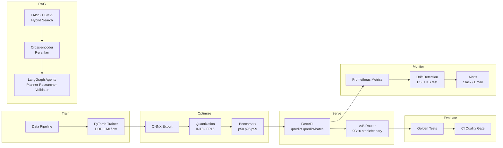

# MLServe: Production ML Platform

End-to-end ML model lifecycle platform: Train, Optimize, Serve, Evaluate, Monitor.

MLServe automates the entire model lifecycle, from distributed training and model optimization through real-time serving with A/B testing, RAG-powered retrieval, automated regression detection, and production monitoring.

## The problem

Most ML models die in Jupyter notebooks. Getting models into production safely, where they handle real traffic, do not silently degrade, and can be tested before deployment, is where 90 percent of ML teams fail. There is no single open-source platform that covers the full lifecycle from training to production monitoring with built-in quality gates.

## The solution

MLServe is an end-to-end platform with 7 integrated modules that handle every stage of the ML lifecycle. It includes CI-gated quality checks (no bad model ships), A/B testing for safe rollouts, RAG-powered intelligent retrieval, and real-time drift detection, all deployed on Kubernetes with infrastructure-as-code.

## Architecture



## Modules

### 1. Training Pipeline (`training/`)

Distributed PyTorch training with `DistributedDataParallel`, multi-GPU support via `torchrun`, data loading with feature engineering, and MLflow experiment tracking. Hyperparameters live in `configs/model_config.yaml`. The example model is a text classifier built on DistilBERT.

```bash
make train
# multi-GPU:
torchrun --nproc_per_node=2 -m training.trainer --config configs/model_config.yaml
```

### 2. RAG Pipeline (`rag/`)

Hybrid retrieval combining FAISS dense search with BM25 keyword search, cross-encoder reranking, and a LangGraph multi-agent flow (Planner, Researcher, Validator). Ships with a small built-in demo corpus so it runs without external data.

```python
from rag.pipeline import RAGPipeline

rag = RAGPipeline()
print(rag.answer("What does the evaluation engine check?"))
```

### 3. Model Optimization (`optimization/`)

PyTorch to ONNX export, INT8 and FP16 quantization, and latency/throughput benchmarking with p50, p95, p99 and requests per second, plus before/after comparison reports.

```bash
make optimize
make benchmark
```

### 4. Serving API (`serving/`)

FastAPI with async inference, single and batch prediction, model versioning with hot reloading, A/B testing via traffic splitting (90/10 stable/canary), health and model info endpoints, Prometheus metrics, and request logging plus rate limiting middleware.

```bash
make serve
```

```bash
curl -X POST http://localhost:8000/predict \
  -H "Content-Type: application/json" \
  -d '{"text": "I love this product"}'

curl -X POST http://localhost:8000/predict/batch \
  -H "Content-Type: application/json" \
  -d '{"texts": ["I love it", "This is awful"]}'

curl http://localhost:8000/health
curl http://localhost:8000/model/info
curl http://localhost:8000/metrics
```

Hot reload a model slot without restarting:

```bash
curl -X POST http://localhost:8000/model/reload \
  -H "Content-Type: application/json" \
  -d '{"slot": "canary", "model_path": "models/latest", "version": "v1.2.0"}'
```

Without a trained model on disk, the API serves predictions from a built-in offline classifier so the full flow works out of the box.

### 5. Evaluation Engine (`evaluation/`)

Golden test dataset runner with 25 labeled cases, automated accuracy, precision, recall, F1, latency, and throughput metrics, regression detection against a baseline, and a CI quality gate that blocks deployment when accuracy drops below 0.85, F1 below 0.80, or p99 latency above 50ms.

```bash
make evaluate
```

This writes `reports/quality.json` and a human-readable `reports/quality.txt`, and exits non-zero on failure so CI blocks the deploy.

### 6. Monitoring (`monitoring/`)

Prometheus metrics (request count, latency histogram, error rate, GPU utilization), data drift detection with PSI and the Kolmogorov-Smirnov test, model drift detection on predicted label distributions, configurable alerting rules with Slack and email notifiers, a pre-built Grafana dashboard, and Prometheus scrape config.

### 7. Infrastructure (`infrastructure/`)

Multi-stage Dockerfile plus docker-compose for local dev (API, Redis, MLflow, Prometheus, Grafana), Kubernetes Deployment, Service, HPA, and Ingress manifests, Terraform for an AWS EKS cluster (VPC, subnets, node groups, IAM roles), and a GitHub Actions pipeline (lint, test, evaluate, build Docker, deploy).

```bash
make docker-up
kubectl apply -f infrastructure/kubernetes/
cd infrastructure/terraform && terraform init && terraform apply
```

## Tech stack

Python 3.11+, PyTorch 2.x, FastAPI, Uvicorn, Pydantic, HuggingFace Transformers, scikit-learn, XGBoost, LangChain, LangGraph, FAISS, ONNX, ONNXRuntime, PySpark, pandas, numpy, MLflow, prometheus-client, Docker, Kubernetes, Terraform, GitHub Actions, PostgreSQL, Redis, pytest, httpx.

## How to run locally

### Bare metal

```bash
pip install -r requirements.txt
make test        # run the full test suite
make serve       # start the API on http://localhost:8000
make evaluate    # run the CI quality gate on golden tests
```

### Docker Compose

```bash
make docker-up
# API: http://localhost:8000
# MLflow: http://localhost:5000
# Prometheus: http://localhost:9090
# Grafana: http://localhost:3000 (admin / mlserve)
```

## Evaluation approach

The golden test set (`data/golden_tests/test_cases.json`) covers positive, negative, and neutral sentiment plus edge cases (single words, mixed sentiment, punctuation-heavy text). Each case carries a minimum confidence floor. The CI gate compares the current model against thresholds from `configs/evaluation_config.yaml` and optionally against a previous report for regression detection. The hardest part of this module was building golden tests that catch real regressions without false positives: thresholds were iterated against test case diversity until the gate was both strict and stable.

## A/B testing

Traffic splitting happens at the serving layer. The router hashes the request id (or the input text) so the same input always lands on the same variant, which keeps experiments reproducible. 90 percent of traffic goes to the stable model and 10 percent to the canary. If canary metrics drop below threshold, it rolls back by reloading the stable model into the canary slot.

## Key decisions and trade-offs

- **Stub predictor by default.** The API runs end to end without downloading a model, which keeps local development and CI fast and offline. Point it at a trained checkpoint when one exists.
- **Hash embeddings in RAG demos.** The demo corpus uses deterministic hash embeddings so the pipeline runs with no downloads. Swap in `SentenceTransformerEmbeddings` for production retrieval quality.
- **Lexical reranker fallback.** The cross-encoder reranker is used when its model is available; otherwise a word-overlap reranker keeps the pipeline working offline.
- **In-house rate limiting.** A small token bucket middleware avoids another dependency and is easy to reason about in tests.
- **SQLite-backed MLflow in compose.** Good enough for local dev; point `MLFLOW_TRACKING_URI` at a hosted server for team use.

## Project structure

```
.
├── training/          # DDP trainer, data pipeline, MLflow tracking
├── rag/               # Hybrid retrieval, reranking, LangGraph agents
├── optimization/      # ONNX export, quantization, benchmarking
├── serving/           # FastAPI app, model manager, A/B router, middleware
├── evaluation/        # Golden tests, metrics, regression detection, CI gate
├── monitoring/        # Prometheus metrics, drift detection, alerting
├── infrastructure/    # Docker, Kubernetes, Terraform
├── configs/           # model, serving, evaluation YAML configs
├── data/golden_tests/ # Golden test cases
├── tests/             # pytest suite (offline, no downloads)
├── Makefile
├── requirements.txt
└── .github/workflows/ci.yml
```

## Future improvements

- GPU-backed inference with TensorRT and dynamic batching
- Shadow deployments alongside A/B testing
- Online learning loop feeding production feedback into retraining
- Feature store integration for the training pipeline
- Canary auto-rollback driven by live Prometheus alerts
